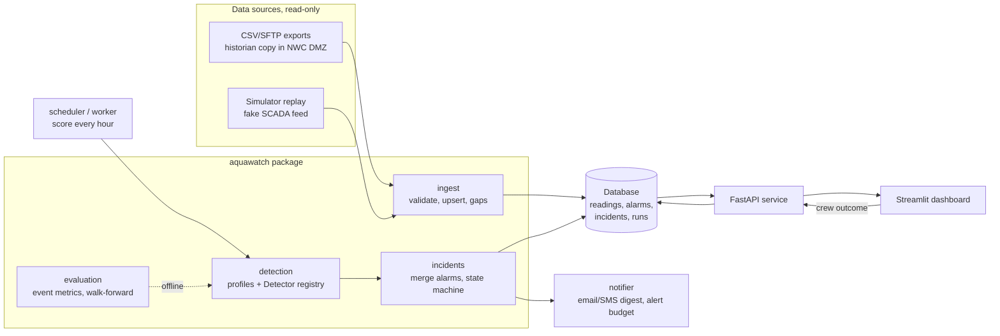

# AquaWatch build guide: from prototype to pilot-ready system

This guide is for building AquaWatch out yourself, one step at a time. It starts from the current repo (after PR #19) and ends at a system that could run in **shadow mode** on real NWC zone data:

- it ingests data read-only
- it scores on a schedule
- it tracks incidents through to a crew outcome
- it is deployable with one command

Every step lists **why**, **what to do**, **where**, and **done when**. Do the steps in order: each one leaves the repo working and tested, and later steps rely on earlier ones.

---

## 0. How to work through this

- **One step = one branch = one PR.** Name branches after the step, for example `a1-package-layout`. Keep PRs small enough for a teammate to review in 20 minutes.
- **Tests first where you can.** Write the "done when" check as a test before the code.
- **The rules in [AGENTS.md](../AGENTS.md) apply to you too:**
  - no labels in training
  - no threshold tuning on the test window
  - report results per leak event against the random baseline
  - no overclaiming
  - no committed models or secrets
- **Results must not move by accident.** Steps marked *(refactor)* must leave every evaluation number unchanged. Step A2 adds a test that enforces this.
- **Agree new dependencies with the team first.** Steps marked *(new dependency)* add a package; get agreement before adding it (AGENTS.md rule).
- **Write down big decisions.** For each 🧭 decision, add a short Architecture Decision Record (ADR) in `docs/adr/NNNN-title.md` covering context, decision and consequences, about 10 lines.

---

## 1. Where you are now

| Area | Today | Gap |
|---|---|---|
| Layout | `src/` modules, `config.py` at root, `sys.path` hacks in 9 scripts and tests | Not an installable package; imports depend on where you run from |
| Config | Module-level constants in `config.py` | Not typed, not per-environment, not recorded with results |
| Detectors | 5 functions with different signatures (`src/baseline.py`, `src/model.py`), wired by hand in `src/pipeline.py` | No shared interface; adding a detector means editing several files |
| Evaluation | Event-level metrics, matched random baseline, one chronological split | No walk-forward; thresholds fixed by hand, never validated |
| Data | CSVs loaded in full, then pandera checks | No storage, no incremental loads, no data-quality history |
| App | Streamlit trains and scores on every run | The UI does the computing; nothing is shared or persisted |
| Alerts | Incident table built on the fly | No workflow, no crew outcomes, so no feedback labels |
| Ops | GitHub Actions CI, uv lock | No container, no scheduled jobs, no logging or monitoring |

## 2. Target architecture



**Principles**
1. **Keep the core pure.** Detection, evaluation and incident logic are plain functions and classes on DataFrames. They never read files, query databases or call the network, so they are easy to test.
2. **Keep input and output at the edges.** Readers, the database repository, the API and the notifier sit outside the core and call into it.
3. **Data flows one way, read-only.** AquaWatch never writes to or controls operational systems.
4. **Every result is reproducible.** Each scoring run stores its data range, its config hash, the model version and the code version.
5. **Humans close the loop.** Every alert becomes an incident, and every incident ends with a crew outcome. Those outcomes are the only real labels you will ever get.

Target layout after Phase A:
```
src/aquawatch/
  config.py           # typed settings
  domain.py           # Reading, Alarm, Incident, LeakEvent types
  io/                 # readers (csv, battledim), later: repository (db)
  detection/          # profiles.py, detectors/*.py, registry.py
  evaluation/         # metrics.py, protocols.py (walk-forward)
  incidents/          # merge.py, workflow.py
  simulation/         # simulate.py (WNTR)
  cli.py              # `aquawatch ...` commands
apps/streamlit_app.py
services/api/         # Phase D
configs/              # detectors.yaml, per-environment settings
tests/  docs/  scripts/ (thin wrappers only)
```

---

## Phase A: Foundation (refactors; results must not change)

### A1. Make it a real package *(refactor)*
- **Why:** imports currently work only because of `sys.path` hacks. A package installs once and imports the same way everywhere: tests, scripts, the app and later the API.
- **Do:**
  1. Move `src/*.py` to `src/aquawatch/`, and `config.py` to `src/aquawatch/config.py`.
  2. In `pyproject.toml`, set `[tool.uv] package = true` and add a build backend (`hatchling`).
  3. Replace `import config` / `from src.x import` with `from aquawatch.x import`.
  4. Delete every `sys.path.insert` block.
  5. Add `[project.scripts] aquawatch = "aquawatch.cli:main"`, with subcommands `evaluate`, `simulate`, `train` and `sizing`. Keep `scripts/*.py` as thin wrappers, or remove them once the docs point to the CLI.
- **Done when:**
  - `git grep -n "sys.path.insert" -- "*.py"` returns nothing
  - `uv run aquawatch evaluate --dataset simulated` prints the same table as before
  - all tests pass

### A2. Lock today's results in a "golden" test *(do this before any other refactor)*
- **Why:** this test is what tells you a refactor really is a refactor.
- **Do:**
  1. Write `tests/test_golden_results.py`, which runs the evaluation on the demo and simulated datasets.
  2. Compare every detector's `events_detected`, `false_episodes` and `alarm_episodes` with a committed JSON snapshot in `tests/golden/`.
  3. Add a `--update-golden` pytest option to refresh the snapshot on purpose.
- **Done when:** changing any threshold in config makes this test fail with a readable diff.

### A3. Typed, versioned configuration *(new dependency: `pydantic-settings`)*
- **Why:** detector thresholds are research parameters. They should be typed, documented, overridable per environment, and stored with every result.
- **Do:**
  1. Create a `Settings` model with nested `DetectorSettings` (thresholds), `PathSettings` and `RuntimeSettings`.
  2. Load defaults from `configs/default.yaml`, override them from environment variables (`AQUAWATCH_...`), and read secrets only from the environment or `.env`.
  3. Add `settings.fingerprint()`, a short hash of the effective detector settings.
- 🧭 **Decision (ADR):** config format and precedence order (YAML defaults, then environment, then CLI flags).
- **Done when:**
  - no module reads `config.py` constants directly
  - the evaluation output prints the config fingerprint
  - the golden test passes

### A4. Domain types
- **Why:** shared names stop every module from inventing its own column conventions.
- **Do:** in `domain.py`, define frozen dataclasses or pydantic models:
  - `LeakEvent` (id, zone, start, end, size)
  - `Alarm` (zone, start, end, detector, score)
  - `Incident` (id, zone, opened_at, alarms, status, outcome, estimated volume)
  - `RunInfo` (run id, data range, config fingerprint, model version, git SHA)

  Keep the hourly readings table as a validated DataFrame (pandera schema), and convert to types only at the boundaries.
- **Done when:** `src/alerts.py` and `src/metrics.py` take and return these types for incidents and events.

### A5. One detector interface and a registry *(refactor)*
- **Why:** each of today's 5 detectors has a different function signature. With one interface, adding a detector touches one file, and the pipeline, evaluation, app and API all pick it up.
- **Do:**
  ```python
  class Detector(Protocol):
      name: str
      def fit(self, history: pd.DataFrame) -> "Detector": ...      # label-free
      def score(self, frame: pd.DataFrame) -> pd.Series: ...        # higher = more unusual
      def alarms(self, frame: pd.DataFrame) -> pd.Series: ...       # 0/1, uses its own threshold
  ```
  - Wrap the flow rule, flow + pressure rule, night flow, CUSUM and Isolation Forest as classes in `detection/detectors/`.
  - Register each in `detection/registry.py`, and make the pipeline loop over the registry.
  - Separate `score` from `alarms` so that Phase B can tune thresholds on validation data.
  - Add a test that runs every registered detector with all label columns removed (extending `test_training_never_reads_labels`).
- **Done when:**
  - `METHODS` and `score_all_methods` are replaced by the registry
  - the golden test passes
  - one test is parameterised over all detectors

### A6. Quality gates in CI
- **Do:**
  - add `mypy` (or `pyright`) in strict mode for `aquawatch/` *(new dependency)*
  - add `pytest-cov` and fail CI below 80% line coverage on `aquawatch/` *(new dependency)*
  - keep ruff, `pip-audit` and `uv lock --check`
  - add `pre-commit` with ruff and the large-file check (the config already exists)
- **Done when:** CI runs lint, type checks, tests with coverage and the golden test on Python 3.11 and 3.13.

---

## Phase B: Detection quality (results will change; document every change)

### B1. Walk-forward evaluation and validation-tuned thresholds
- **Why:** thresholds are currently picked by hand. The honest approach is to tune on a validation window, test on later windows, and report the spread of results.
- **Do:**
  1. In `evaluation/protocols.py`, write `walk_forward(df, train_days, val_days, test_days, step_days)`, which yields folds.
  2. In each fold, fit on train, then pick each detector's threshold on the validation window to meet an **alarm budget**, for example at most 1 false alarm per zone-week. Score the test window with that threshold.
  3. Report the mean and range across folds, plus the pooled event counts with 95% confidence intervals.
- **Done when:** `aquawatch evaluate --protocol walk-forward` prints per-fold and pooled tables, and `DATASHEET.md` explains the protocol.

### B2. Intermittent supply (Jamaica-specific)
- **Why:** NWC runs many zones on supply schedules. When supply returns, the refill surge looks like a leak.
- **Do:**
  1. In the simulator, add per-zone lock-off schedules: close the inlet with WNTR time controls, for example 22:00–05:00.
  2. Add a `supply_on` column to the readings and the schema.
  3. Add `detection/supply.py`, which infers on/off periods from flow when no schedule is given.
  4. Make every detector ignore off-periods plus a refill window, configurable (for example 3 h).
  5. Show supply hours in the app.
- **Done when:** on a simulation with lock-offs, refills cause no false alarms, and leak recall is reported separately for intermittent zones.

### B3. Better features and combined detectors
- **Do:**
  - Add persistence features for Isolation Forest (rolling 6–24 h residual, night residual, CUSUM statistic).
  - Add a `VotingDetector` that alarms when at least *k* of a chosen set of detectors agree.
  - Run an ablation table: with and without pressure, persistence and voting.
- **Done when:** walk-forward results show whether each addition helps, and only changes that beat the baseline become defaults.

### B4. Model card and datasheets
- **Do:** write `docs/MODEL_CARD.md` covering intended use, what the model is not for, training data, metrics with confidence intervals, known failure modes (supply cuts, small leaks in big zones, seasonal drift) and an update policy.

---

## Phase C: Data platform

### C1. Storage *(new dependency)*
- 🧭 **Decision (ADR):** **DuckDB** (a single file, no server; good for a student team and offline demos) or **PostgreSQL + TimescaleDB** (pilot-grade, multi-user). Recommendation: start with DuckDB behind a repository interface, and switch later without touching the core.
- **Do:**
  - Create the tables:
    - `readings(zone, ts, flow, pressure, source, ingested_at)`, with primary key `(zone, ts)`
    - `zones(zone, mean_inflow, customers, supply_schedule)`
    - `alarms`, `incidents`, `incident_events` (an audit trail)
    - `runs` (`RunInfo`)
  - Add `io/repository.py` with `ReadingsRepo`, `IncidentRepo` and `RunRepo`, and keep all SQL inside it.
  - Manage schema changes with plain numbered SQL migration files in `migrations/`.
- **Done when:** repository tests pass against a temporary database, and the core imports no SQL.

### C2. Ingestion
- **Do:**
  - `aquawatch ingest <file|folder>` reads CSV exports, validates them with the schema, maps units, and upserts idempotently (loading the same file twice changes nothing).
  - It records data-quality issues (gaps, flatlines, out-of-range values, duplicates) in a `dq_issues` table.
  - Add `aquawatch replay --speed 3600x` to stream simulator or BattLeDIM data into the database as a fake live feed for demos and tests.
- **Done when:** ingesting the simulated CSV twice leaves an identical database, and a file with a gap produces a data-quality record.

### C3. Scheduled scoring job
- **Do:**
  - `aquawatch score --since last` loads the needed history from the repository and fits or loads detectors by model version.
  - It scores only the new hours, writes alarms, and merges them into incidents using `incidents/merge.py` (today's 12 h merge rule, as a function).
  - Run it hourly with a simple scheduler such as APScheduler, cron or Windows Task Scheduler.
  - The job must be **idempotent**: re-running the same hour creates no duplicates.
- **Done when:** with replay running, incidents appear in the database within one scoring cycle, and re-running the job changes nothing.

---

## Phase D: Service and workflow

### D1. Incident workflow (state machine)
```
NEW -> ACKNOWLEDGED -> FIELD_CHECK -> CLOSED(outcome)
outcome in {LEAK_CONFIRMED, NO_LEAK_FOUND, DATA_ISSUE, PLANNED_WORK, THEFT_SUSPECTED}
```
- **Do:**
  - Implement allowed transitions in `incidents/workflow.py`. Each transition writes an `incident_events` row (who, when, note).
  - Closed outcomes become **real labels** in a `field_outcomes` view, ready for future evaluation on real data.
- **Done when:** an illegal transition raises an error, and every change is audited.

### D2. API *(new dependency: FastAPI, uvicorn)*
- **Do:** create `services/api/` with these endpoints:
  - `GET /health` (including data freshness)
  - `GET /zones`, `GET /zones/{id}/readings?from&to`
  - `GET /incidents?status=`, `GET /incidents/{id}`, `PATCH /incidents/{id}` (status and outcome)
  - `GET /runs/latest` (config fingerprint, model version)

  Use API-key auth from the environment, store no secrets in code, and rely on the generated OpenAPI docs. Keep the API thin: it calls repositories and the workflow, never detection.
- **Done when:** API tests with FastAPI's `TestClient` cover every endpoint, including auth failures and illegal transitions.

### D3. Streamlit reads from the API
- **Do:** split the app into a **live view** (zones, incidents, acknowledge/close buttons through the API) and a **research view** (today's offline evaluation and Insights tabs). Remove scoring from the live view.
- **Done when:** the live view works with the scoring job and API running, and shows nothing it computed itself.

### D4. Notifications
- **Do:**
  - Write a `Notifier` interface with `EmailNotifier` and `SmsNotifier`, plus a `ConsoleNotifier` as the default dry run.
  - Send a daily digest plus immediate alerts only for high-priority incidents.
  - Enforce an **alert budget** per zone per day, so the tool never floods crews.
- 🧭 **Decision (ADR):** channels and cost. WhatsApp and SMS charge per message (see `reports/AquaWatch industry readiness.md`).
- **Done when:** a replayed leak triggers exactly one alert, and the budget suppresses duplicates.

---

## Phase E: Operate and pilot

### E1. Containers *(new tooling: Docker)*
- `Dockerfile` (uv-based, non-root user) and `docker-compose.yml` with `db` (if PostgreSQL), `api`, `worker` and `dashboard`. Configure everything through environment variables, and ship a `.env.example` with no secrets.
- **Done when:** `docker compose up` followed by `aquawatch replay` gives a working demo on a clean machine.

### E2. Observability
- Use structured JSON logs with a run id on every line.
- Track metrics: data freshness per zone, alarms and incidents per day, scoring duration, data-quality issues.
- Run **sensor-health checks** (flatline, stuck value, out of range) separately from leak alerts, so a broken meter is never reported as a leak.
- **Done when:** `/health` reports stale zones, and a flatline in replay data creates a data-quality incident, not a leak incident.

### E3. Model versioning and retraining
- Use a `models/registry/` with versioned skops files and metadata (start simple; MLflow later if needed).
- Use a **champion/challenger** setup: the challenger scores in shadow, and is promoted only if walk-forward results are better.
- Add a scheduled retrain, for example monthly, gated by the golden and quality tests.
- **Done when:** every alarm row references a model version, and rolling back is a one-line config change.

### E4. Security and governance for a pilot
Follow `reports/AquaWatch industry readiness.md` (governance section):
- **Data flow:** one way and read-only, from an export or historian copy in NWC's DMZ. No inbound access to operational systems.
- **Network diagram:** zones and conduits (IEC 62443), checked against NIST CSF 2.0.
- **Data:** zone aggregates only, so no customer data. Retention limits.
- **Paperwork:** the data-sharing agreement, NDA and MoU need a lawyer's review.
- **Repo security:** dependency audit in CI, secret scanning, and least-privilege API keys.

### E5. Shadow-mode pilot runbook
Write `docs/PILOT_RUNBOOK.md`:
1. **Offline back-test:** run on one historical DMA extract and compare with NWC repair logs.
2. **Shadow mode:** the system runs live but alerts only the project team, for at least 8 weeks.
3. **Live alerts:** to one NWC contact, with field outcomes recorded.

Agree exit criteria with NWC in advance (for example precision of field-checked alerts, lead time, false alarms per zone-week) and how results will be reported.

---

## Suggested schedule (part-time, 2–3 people)

| Weeks | Steps | Milestone |
|---|---|---|
| 1–2 | A1, A2, A3 | Installable package, golden test, typed config |
| 3–4 | A4, A5, A6 | Detector registry, strict CI |
| 5–7 | B1, B2 | Walk-forward results; supply-cut handling |
| 8–9 | B3, B4 | Feature and voting ablation; model card |
| 10–12 | C1, C2, C3 | Database, ingestion, hourly scoring job with replay |
| 13–15 | D1, D2, D3, D4 | Incident workflow, API, live dashboard, notifications |
| 16–18 | E1–E5 | Docker deployment, monitoring, model registry, pilot runbook |

**Minimum viable pilot:** A1–A5, B1, B2, C1–C3, D1–D3, E1 and E4. B3, B4, D4, E2 and E3 make it robust, but a first shadow pilot can run without them.

## Checklist before calling a step done
- [ ] Tests for the new behaviour, written first where possible; `ruff`, type checks and `pytest` pass
- [ ] The golden test passes, or the snapshot was updated on purpose with the reason in the PR
- [ ] Event-level results re-run if detection changed; DATASHEET and data notes updated
- [ ] An ADR written if a 🧭 decision was made
- [ ] Docs and README updated; new commands added to AGENTS.md
- [ ] No secrets, models, raw external data or personal data committed
